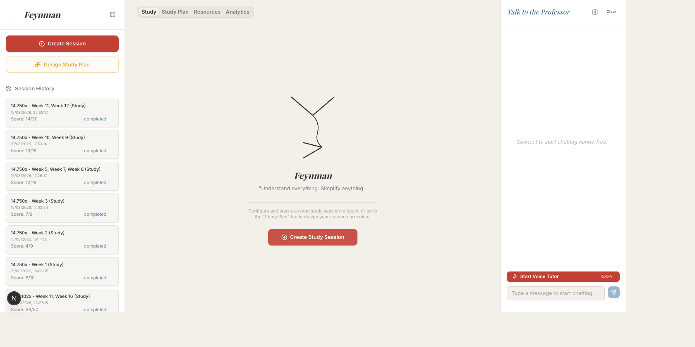
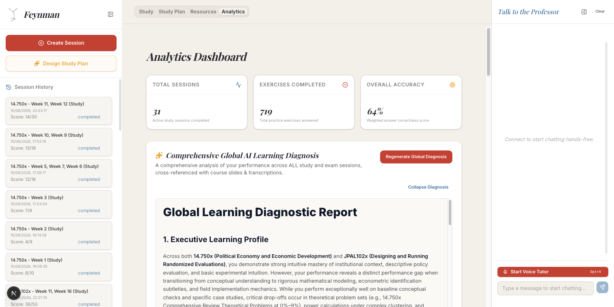

# 🎓 Feynman DEDP Study Platform
### *Personal Socratic AI Tutor & Adaptive Workspace for MIT DEDP MicroMasters*

<p align="center">
  <svg viewBox="40 112 260 260" width="180" height="180" xmlns="http://www.w3.org/2000/svg">
    <g stroke="#2C2E33" stroke-width="2" fill="none" stroke-linecap="round" stroke-linejoin="round">
      <line x1="100" y1="120" x2="170" y2="180" stroke-width="3"/>
      <line x1="240" y1="120" x2="170" y2="180" stroke-width="3"/>
      <path d="M 170 180 Q 195 205 185 240 Q 178 265 200 285" stroke-width="2.2" stroke-dasharray="0.1 8"/>
      <line x1="200" y1="285" x2="140" y2="270" stroke-width="3"/>
      <line x1="200" y1="285" x2="140" y2="320" stroke-width="3"/>
    </g>
    <text 
      x="200" 
      y="360" 
      font-family="Georgia, serif" 
      font-size="24" 
      font-style="italic"
      font-weight="bold"
      fill="#2C2E33" 
      text-anchor="middle"
    >
      Feynman
    </text>
  </svg>
</p>

The **Feynman DEDP Study Platform** is a highly personalized, adaptive, and visually rich educational workspace designed to help students master **MIT’s Data, Economics, and Development Policy (DEDP) MicroMasters** curriculum. 

Instead of passive, cookie-cutter cramming, the platform transforms static textbooks, lecture slide decks, and transcripts into an interactive, **hands-free Socratic learning environment**. It utilizes sophisticated AI reasoning, real-time bidirectional voice tutoring, performance-based adaptive question mixes, and detailed econometric diagnostics to identify and bridge your critical conceptual gaps.

---

## 🚀 Key Features & Visual Walkthrough

### 1. Secure Passcode-Gated Entry
A clean, secure, and physics-themed entrance gates access to your personal study workspace. Simply enter your encrypted passcode to authenticate and retrieve your personalized learning metrics.

<p align="center">
  
</p>

---

### 2. Socratic Study Workspace & Hands-Free Voice Panel
The core study interface features an interactive, keyboard-navigable flashcard engine supporting **fully typeset LaTeX mathematical formulas** and clean formatting.
* **Talk to the Professor**: On the right, a real-time, hands-free voice interface connects you to a virtual Richard Feynman who listens to your reasoning, dynamically explains concepts, and guides you to the correct answer.
* **Session Sidebar**: Keep track of your progress, scores, and active sessions on the left.

<p align="center">
  
</p>

---

### 3. Adaptive Session Tuner & Filter Controls
Before starting a session, configure the optimal focus for your study.
* **Practice vs. Timed Exam**: Study at your own pace with AI assistance, or test yourself under strict exam conditions.
* **Sourcing Mix**: Combine ingested historical questions with fresh, AI-generated variants modeled after MIT's cognitive traps.
* **Retrieval Focus**: Select customized proportions for your syllabus focus: *Remedial Sprint* (focusing on weak areas), *Fresh Exploration* (unseen topics), or *Maintenance Review* (spaced review of mastered topics).

<p align="center">
  
</p>

---

### 4. Recharts-Powered Performance Analytics
An analytical dashboard tracks your progress across **700+ practice exercises** and multiple courses.
* **Global AI Learning Diagnosis**: An executive diagnostic report deconstructs your learning profile, pinpointing exact conceptual gaps (e.g., *Leader Effects in Autocracies vs. Democracies*, *Nathan Nunn's 2008 Slave Trade Robustness Analysis*, or *Intra-Cluster Correlation in Clustered Randomized Controlled Trials*).
* **Interactive Accuracy Heatmaps**: Color-coded calendars map your accuracy percentage across all weeks and modules. Clicking on any week drills down into subtopic performance and lists direct links to related slides and transcripts in the workspace.

<p align="center">
  
</p>

---

### 5. AI Socratic Academic Planner
Interact with an AI Academic Advisor to design a custom, multi-day curriculum. Simply type in your availability (e.g., *"I have 2 hours a day from Tuesday to Friday"*), and the planner generates an optimal, step-by-step study schedule mapped to your weakest categories.

<p align="center">
  
</p>

---

### 6. Course Resources Registry & Feynman Guides
The Resources tab catalogues all ingested course assets:
* **PDF Lecture Slides & Transcripts**: Click on any document or highlighted quote to open the source materials in the course visualizer.
* **Feynman Study Guides**: Generate concept-demystifying, highly intuitive lecture summaries that use analogies, diagrams, and step-by-step model breakdowns to explain the core intuition behind complex economic models.

<p align="center">
  
</p>

---

## 🛠️ Tech Stack & Architecture

* **Frontend**: React 19, [Next.js 16](https://nextjs.org/) (App Router), Tailwind CSS 4, and [shadcn/ui](https://ui.shadcn.com/)
* **Database & ORM**: SQLite database managed with [Prisma ORM](https://www.prisma.io/)
* **AI Integration**: Vercel AI SDK (`ai`), `@ai-sdk/google` using Google Gemini models (`gemini-2.0-flash`, `gemini-1.5-pro`)
* **Interactive Charts**: Responsive data visualization powered by [Recharts](https://recharts.org/)
* **Formulas & Markdown**: LaTeX mathematical formatting typeset via [KaTeX](https://katex.org/)
* **Data Ingestion**: Custom Puppeteer crawler and parser scripts for unzipping, reading, and indexing PDFs/CSVs/Markdowns.

---

## 📂 Project Structure

```
dedp/
├── MIT_Learn_Courses/         # Ingested syllabus slide PDFs, transcripts, and metadata
├── web/                       # The Next.js web application
│   ├── prisma/                # SQLite database schema definition (schema.prisma)
│   ├── public/                # Static assets (SVGs, icons, screenshots)
│   ├── src/
│   │   ├── app/               # Server Actions, layout, and page routes
│   │   ├── components/        # React interface widgets (StudyInterface, Charts, Forms)
│   │   ├── hooks/             # Custom React hooks (Live API websockets, timers)
│   │   ├── services/          # Prisma database service layers & ingestion handlers
│   │   └── scripts/           # Seeding, cleanup, and validation helpers
│   └── package.json           # Web app configuration and script commands
├── package.json               # Parent directory configuration
└── check_auth.js              # MIT crawler authentication helper
```

---

## ⚡ Quick Setup

### 1. Install Dependencies
Navigate into the `web` folder and install NPM packages:
```bash
cd web
npm install
```

### 2. Configure Environment Variables
Create a local `.env` file from the example template:
```bash
cp .env.example .env
```
Open `.env` and set:
* `GOOGLE_API_KEY`: Your Google AI Studio Gemini API key.
* `APP_PASSCODE`: A secure passcode used to log into the application.
* `DATABASE_URL`: Set to `file:./dev.db` for local SQLite development.

### 3. Initialize Database
Apply database schemas and migrate:
```bash
npx prisma db push
```

### 4. Seed Course Data
Populate your local database with crawled topics, slides, and exercises:
```bash
npx tsx src/scripts/seed.ts
```

### 5. Run the Server
Launch the development server:
```bash
npm run dev
```
Open [http://localhost:3000](http://localhost:3000) in your browser and log in with your `APP_PASSCODE`.

---

## 📖 Deep Architectural Specs

For deep dives into the algorithms, features, and engineering designs powering this application, read our dedicated specification files inside the `web` directory:
* **[QUESTION_GENERATION.md](web/QUESTION_GENERATION.md)**: Details on the Adaptive Sourcing Mix, Iterative Background Generation, Cognitive-Trap Diagnosis, "One-Wrong-Cancels-One-Right" Scoring, and Socratic Schedulers.
* **[FEYNMAN_MAGI_DESIGN.md](web/FEYNMAN_MAGI_DESIGN.md)**: Vision on shareable workspaces and Multi-Agent Econometric Policy Debates ("MAGI").
* **[IDEAS_GRAPH_RAG.md](web/IDEAS_GRAPH_RAG.md)**: specs for relational knowledge graph ingestion pipelines using GraphRAG.

---

## 🔮 The 10x Vision & Student-Centric Roadmap

Our development strategy is centered around building an **open-source, private-first workspace** where any student can upload their own materials and let the platform's AI automatically parse, index, and organize them into a personalized Socratic curriculum.

### Phase 1: Codebase Modularization & Auto-Ingestion (Immediate Roadmap)
1. **Service Extraction (`src/services/`)**: Separating monolithic code inside `actions.ts` into thin, domain-driven services (`sessionService.ts`, `diagnosticService.ts`, `studyPlanService.ts`) to improve maintainability.
2. **Universal Drag-and-Drop Uploader**: Upgrading the database ingestion logic (`web/src/services/ingest.ts`) to support uploading custom study PDFs, slides, or transcripts directly through the web user interface.
3. **AI-Driven Auto-Organization**: Integrating a structured schema extraction layer. When a student uploads a new document, the system automatically uses Gemini (`generateObject`) to:
   * **Identify & Title** the core academic course, week, and session.
   * **Segment** the document into distinct, coherent study topics.
   * **Generate** a localized mock question database modeling potential cognitive traps based *solely* on that uploaded text.
4. **Frontend Component Decomposition**: Decomposing monolithic view elements into highly isolated sub-components (`StudyHeader.tsx`, `ActiveSessionPanel.tsx`, `DiagnosticReportView.tsx`) managed by a custom `useStudySession.ts` state hook to eliminate React re-render lag.

### Phase 2: The 10x Cognitive Blueprint (Upcoming AI Core)
1. **Multi-Modal Deep Graph RAG (Knowledge Graphs)**:
   * As students upload various files (notes, books, papers), the system builds a prerequisite concept dependency web. If a student makes conceptual errors during study, the AI backtracks through the dependency nodes to dynamically synthesize custom remedial lessons.
2. **Dual-Stream Shared Chalkboard (Gemini Live Audio-Video API)**:
   * A real-time, bidirectional audio-visual chalkboard allowing students to draw math models or write out equations. The Socratic AI Professor analyzes their drawings live and actively annotates corrections on the virtual whiteboard.
3. **SM-17 Cognitive Spaced Repetition (AI-Drills)**:
   * Analyzes answer latency and reasoning steps to calculate retention decay and automatically sends short, micro-habit AI study drills to keep performance high.
4. **Interactive Peer-Group AI Debate Seminars**:
   * Collaborative mock seminars with 3 AI peer students who hold different perspectives or skill levels. The AI peers debate a policy or proof, make logical mistakes, and challenge you to step in, identify their fallacies using the Feynman Technique, and defend your model.

---

## 🛡️ Legals, Copyright & Compliance Safety-Net

This repository has been structured with extreme legal rigor to protect both developers and contributors. By enforcing the boundaries below, this project establishes a bulletproof copyright and safety-net defense:

### 1. Zero Copyrighted Materials Distributed
* **No Content Hosting**: **This repository contains exactly 0% copyrighted lecture slide PDFs, protected university transcripts, protected test questions, or proprietary textbooks.** 
* **Local-Only Execution**: The codebase is a set of open-source algorithmic instructions. All data ingestion, crawling, or seeding (`seed.ts`, `check_auth.js`) occurs **entirely locally on the student's personal machine**.
* **Personal Authorization**: The platform only processes files that the student already has legitimate, authorized personal access to (such as files downloaded under their own credentials on university edX/MITx portals or course directories).

### 2. Creative Commons (CC BY-NC-SA 4.0) Compliance
Any study materials from MIT OpenCourseWare (OCW) or public MITx courses are protected under Creative Commons BY-NC-SA 4.0. This repository fully complies with and enforces this license:
* **Attribution (BY)**: Appropriate credit is programmatically and visually given to MIT OpenCourseWare and original faculty authors (*Benjamin Olken*, *Abhijit Banerjee*, *Esther Duflo*, *Daron Acemoglu*, etc.) in all dashboards.
* **Strict Non-Commercial Use (NC)**: This project contains **zero** commercial intent, advertising, paywalls, premium tiers, or SaaS monetization. It is shared for free as an open-source educational utility under the MIT software license. It is strictly for personal, non-commercial self-study.
* **ShareAlike (SA)**: Any adapted, modified, or fork version of this codebase that integrates original or derivative CC-licensed educational files must be shared under the exact same **CC BY-NC-SA 4.0** license terms.

### 3. Legal Safe Harbor & Disclaimers
* **Unofficial Educational Tool**: This is an independent, unofficial study platform developed by students, for students. It has **no** endorsement, affiliation, sponsorship, joint venture, or authorization from the Massachusetts Institute of Technology (MIT), edX, MITx, or the JPAL program.
* **Trademark Use**: The terms "MIT", "MITx Online", "MIT OpenCourseWare", and all related logos are trademarks of their respective owners. They are used here purely for nominative, descriptive, and non-commercial educational purposes, which qualifies as Fair Use under trademark law.
* **Takedown & Good Faith Compliance**: In the event that any institution, copyright holder, or faculty member objects to any code reference or default indexing pattern, we commit to immediate good-faith cooperation. Please file an issue on this repository, and any references will be removed or altered within 24 hours.

### 4. Software License
The software's structural source code, database structures, and Next.js interfaces are released under the open-source **MIT License**. Any local, user-supplied course assets or processed metadata remain under the respective intellectual property licenses of their original authors or the **CC BY-NC-SA 4.0** license.

---

### *“Understand everything. Simplify anything.”* — Richard Feynman

