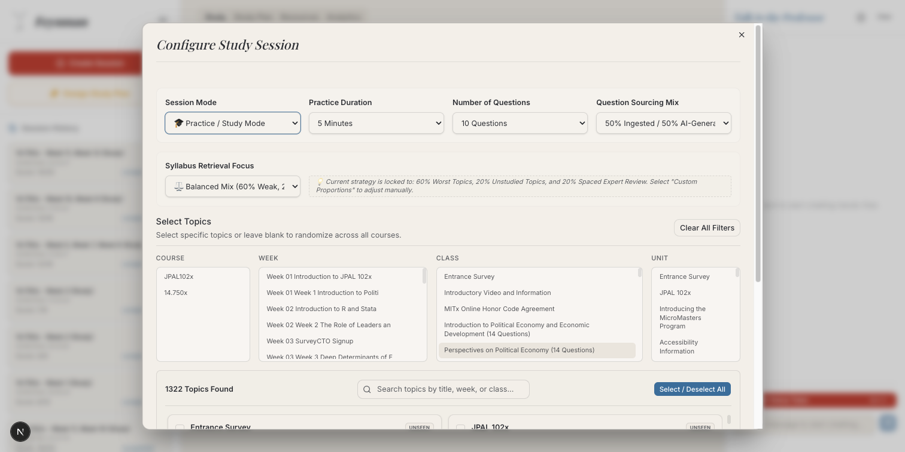

# 🎓 Feynman DEDP Study Platform
### *Personal Socratic AI Tutor & Adaptive Workspace for MIT DEDP MicroMasters*

The **Feynman DEDP Study Platform** is a highly personalized, adaptive, and visually rich educational workspace designed to help students master **MIT’s Data, Economics, and Development Policy (DEDP) MicroMasters** curriculum. 

Instead of passive, cookie-cutter cramming, the platform transforms static textbooks, lecture slide decks, and transcripts into an interactive, **hands-free Socratic learning environment**. It utilizes sophisticated AI reasoning, real-time bidirectional voice tutoring, performance-based adaptive question mixes, and detailed econometric diagnostics to identify and bridge your critical conceptual gaps.

---

## 🚀 Key Features & Visual Walkthrough

### 1. Secure Passcode-Gated Entry
A clean, secure, and physics-themed entrance gates access to your personal study workspace. Simply enter your encrypted passcode to authenticate and retrieve your personalized learning metrics.

<p align="center">
  
</p>

---

### 2. Socratic Study Workspace & Hands-Free Voice Panel
The core study interface features an interactive, keyboard-navigable flashcard engine supporting **fully typeset LaTeX mathematical formulas** and clean formatting.
* **Talk to the Professor**: On the right, a real-time, hands-free voice interface connects you to a virtual Richard Feynman who listens to your reasoning, dynamically explains concepts, and guides you to the correct answer.
* **Session Sidebar**: Keep track of your progress, scores, and active sessions on the left.

<p align="center">
  
</p>

---

### 3. Adaptive Session Tuner & Filter Controls
Before starting a session, configure the optimal focus for your study.
* **Practice vs. Timed Exam**: Study at your own pace with AI assistance, or test yourself under strict exam conditions.
* **Sourcing Mix**: Combine ingested historical questions with fresh, AI-generated variants modeled after MIT's cognitive traps.
* **Retrieval Focus**: Select customized proportions for your syllabus focus: *Remedial Sprint* (focusing on weak areas), *Fresh Exploration* (unseen topics), or *Maintenance Review* (spaced review of mastered topics).

<p align="center">
  
</p>

---

### 4. Recharts-Powered Performance Analytics
An analytical dashboard tracks your progress across **700+ practice exercises** and multiple courses.
* **Global AI Learning Diagnosis**: An executive diagnostic report deconstructs your learning profile, pinpointing exact conceptual gaps (e.g., *Leader Effects in Autocracies vs. Democracies*, *Nathan Nunn's 2008 Slave Trade Robustness Analysis*, or *Intra-Cluster Correlation in Clustered Randomized Controlled Trials*).
* **Interactive Accuracy Heatmaps**: Color-coded calendars map your accuracy percentage across all weeks and modules. Clicking on any week drills down into subtopic performance and lists direct links to related slides and transcripts in the workspace.

<p align="center">
  
</p>

---

### 5. AI Socratic Academic Planner
Interact with an AI Academic Advisor to design a custom, multi-day curriculum. Simply type in your availability (e.g., *"I have 2 hours a day from Tuesday to Friday"*), and the planner generates an optimal, step-by-step study schedule mapped to your weakest categories.

<p align="center">
  
</p>

---

### 6. Course Resources Registry & Feynman Guides
The Resources tab catalogues all ingested course assets:
* **PDF Lecture Slides & Transcripts**: Click on any document or highlighted quote to open the source materials in the course visualizer.
* **Feynman Study Guides**: Generate concept-demystifying, highly intuitive lecture summaries that use analogies, diagrams, and step-by-step model breakdowns to explain the core intuition behind complex economic models.

<p align="center">
  
</p>

---

## 🛠️ Tech Stack & Architecture

* **Frontend**: React 19, [Next.js 16](https://nextjs.org/) (App Router), Tailwind CSS 4, and [shadcn/ui](https://ui.shadcn.com/)
* **Database & ORM**: SQLite database managed with [Prisma ORM](https://www.prisma.io/)
* **AI Integration**: Vercel AI SDK (`ai`), `@ai-sdk/google` using Google Gemini models (`gemini-2.0-flash`, `gemini-1.5-pro`)
* **Interactive Charts**: Responsive data visualization powered by [Recharts](https://recharts.org/)
* **Formulas & Markdown**: LaTeX mathematical formatting typeset via [KaTeX](https://katex.org/)
* **Data Ingestion**: Custom Puppeteer crawler and parser scripts for unzipping, reading, and indexing PDFs/CSVs/Markdowns.

---

## 📂 Project Structure

```
dedp/
├── MIT_Learn_Courses/         # Ingested syllabus slide PDFs, transcripts, and metadata
├── web/                       # The Next.js web application
│   ├── prisma/                # SQLite database schema definition (schema.prisma)
│   ├── public/                # Static assets (SVGs, icons, screenshots)
│   ├── src/
│   │   ├── app/               # Server Actions, layout, and page routes
│   │   ├── components/        # React interface widgets (StudyInterface, Charts, Forms)
│   │   ├── hooks/             # Custom React hooks (Live API websockets, timers)
│   │   ├── services/          # Prisma database service layers & ingestion handlers
│   │   └── scripts/           # Seeding, cleanup, and validation helpers
│   └── package.json           # Web app configuration and script commands
├── package.json               # Parent directory configuration
└── check_auth.js              # MIT crawler authentication helper
```

---

## ⚡ Quick Setup

### 1. Install Dependencies
Navigate into the `web` folder and install NPM packages:
```bash
cd web
npm install
```

### 2. Configure Environment Variables
Create a local `.env` file from the example template:
```bash
cp .env.example .env
```
Open `.env` and set:
* `GOOGLE_API_KEY`: Your Google AI Studio Gemini API key.
* `APP_PASSCODE`: A secure passcode used to log into the application.
* `DATABASE_URL`: Set to `file:./dev.db` for local SQLite development.

### 3. Initialize Database
Apply database schemas and migrate:
```bash
npx prisma db push
```

### 4. Seed Course Data
Populate your local database with crawled topics, slides, and exercises:
```bash
npx tsx src/scripts/seed.ts
```

### 5. Run the Server
Launch the development server:
```bash
npm run dev
```
Open [http://localhost:3000](http://localhost:3000) in your browser and log in with your `APP_PASSCODE`.

---

## 📖 Deep Architectural Specs

For deep dives into the algorithms, features, and engineering designs powering this application, read our dedicated specification files inside the `web` directory:
* **[QUESTION_GENERATION.md](web/QUESTION_GENERATION.md)**: Details on the Adaptive Sourcing Mix, Iterative Background Generation, Cognitive-Trap Diagnosis, "One-Wrong-Cancels-One-Right" Scoring, and Socratic Schedulers.
* **[FEYNMAN_MAGI_DESIGN.md](web/FEYNMAN_MAGI_DESIGN.md)**: Vision on shareable workspaces and Multi-Agent Econometric Policy Debates ("MAGI").
* **[IDEAS_GRAPH_RAG.md](web/IDEAS_GRAPH_RAG.md)**: specs for relational knowledge graph ingestion pipelines using GraphRAG.

---

## 🔮 The 10x Vision & Technical Roadmap

Our plan is structured in two distinct phases: immediate refactoring to solidify the Next.js core, followed by a series of paradigm-shifting educational upgrades.

### Phase 1: Codebase Modularization (Immediate Roadmap)
To improve maintainability, prevent layout bottlenecks, and streamline compilation times, we are separating our monolithic hubs (`src/app/actions.ts` and `src/components/features/StudyInterface.tsx`) into clean domain layers:
1. **Service Extraction (`src/services/`)**:
   * `sessionService.ts`: Manage study session progress, metrics recording, and database logging.
   * `diagnosticService.ts`: Handle prompt compilers, error logs, and LaTeX pre-processing.
   * `studyPlanService.ts`: Focus on chronological syllabus generators and JSON formatted curriculum maps.
2. **Frontend Component Decomposition (`src/components/features/study/`)**:
   * Extract state management into a custom, type-safe `useStudySession.ts` hook.
   * Isolating independent sub-components: `StudyHeader.tsx` (sidebar state), `ActiveSessionPanel.tsx` (cards & page views), and `DiagnosticReportView.tsx` (charts and post-exam reports) to prevent unnecessary top-level re-renders.

### Phase 2: The 10x Product Blueprint (Upcoming Upgrades)
To turn this dashboard into a category-defining educational tool, we have mapped out four groundbreaking AI features:
1. **Multi-Modal Deep Graph RAG (Knowledge Graphs)**:
   * Build a prerequisite concept dependency web. If a student consistently gets *Instrumental Variables* questions wrong, the AI traverses backward to the prerequisite nodes (*OLS assumptions*, *Endogeneity*) to dynamically construct an interactive remedial lesson.
2. **Dual-Stream Shared Chalkboard (Gemini Live Audio-Video API)**:
   * Integrate real-time audio and canvas streaming to create a digital workspace where students can draw math models or sketch utility curves. The AI Professor analyzes their drawings live and annotates corrections on their screen.
3. **SM-17 Cognitive Spaced Repetition (AI-Drills)**:
   * Analyze answer latency and mathematical step patterns to predict the exact day a concept falls below a 90% retention curve. The engine auto-schedules 5-minute cognitive drills delivered via web or mobile.
4. **Interactive Peer-Group AI Debate Seminars**:
   * Enter collaborative mock seminars with 3 AI peer students (with distinct cognitive learning personas, e.g., the *proof-seeker*, the *policy-maker*, and the *struggling intuitive*). The professor poses a policy question, the peers debate, and the student's task is to step in, spot logical fallacies using the Feynman Technique, and defend their econometric models.

### Sibling Products: Path A (SaaS Workspace) vs. Path B (MAGI World Model)
* **Path A: Generic Shareable Course Workspace**: Abstract the ingestion pipeline so students or teachers can drag-and-drop any academic PDF to instantly generate an interactive study guide and shareable workspace link.
* **Path B: Macro Policy World Model ("MAGI")**: Create an econometric sandbox where users submit any tax or spending policy, and 50 census-modeled demographic AI agents execute utility formulas to debate, vote, and dynamically recalculate national indicators (Gini, GDP, Inflation).

---

## 🛡️ Copyright, Licensing & Legal Compliance

Because this application interfaces with official university course curricula, we enforce strict compliance guidelines to ensure legal and ethical usage:

### 1. Creative Commons Compatibility (CC BY-NC-SA 4.0)
Most educational materials published on **MIT OpenCourseWare (OCW)** and public **MITx** modules are distributed under the **Creative Commons Attribution-NonCommercial-ShareAlike** license. If you host, fork, or redistribute this repository, you **MUST** strictly adhere to these three pillars:
* **Attribution (BY)**: You must give appropriate credit to MIT OpenCourseWare and the respective faculty authors (such as *Benjamin Olken*, *Abhijit Banerjee*, *Esther Duflo*, *Daron Acemoglu*, etc.) in any deployed version or derivative work.
* **Non-Commercial (NC)**: You may **NOT** sell, monetize, or charge access fees for this application or any derivative work. This is a 100% free, non-commercial educational study helper.
* **ShareAlike (SA)**: Any transformed, adapted, or extended version of this software must be released under the exact same **CC BY-NC-SA 4.0** license.

### 2. Legal Disclaimers
* **Unofficial Companion**: This project is an independent, unofficial study companion developed by developers for personal educational use. It has **no** affiliation, sponsorship, endorsement, or joint venture with the Massachusetts Institute of Technology (MIT), edX, MITx, or the JPAL Global program.
* **No Trademark Misuse**: The names "MIT", "MITx Online", "MIT OpenCourseWare", and official university seals or logos are trademarks of their respective owners. They are used in this repository purely for descriptive, educational purposes, and do not imply any relationship or endorsement.
* **Personal Ingestion Guidelines**: The crawler utilities (such as `check_auth.js`) are intended to help students index and query materials they already have legitimate, authorized access to on the university portals. No commercial harvesting or unauthorized redistribution of private university exams/materials is supported or encouraged.

### 3. Open Source License
The application source code is distributed under the **MIT License**, while any embedded educational course content or derivative schemas derived from crawled course assets remain governed under the **Creative Commons BY-NC-SA 4.0 License** of the original authors.

---

### *“Understand everything. Simplify anything.”* — Richard Feynman

