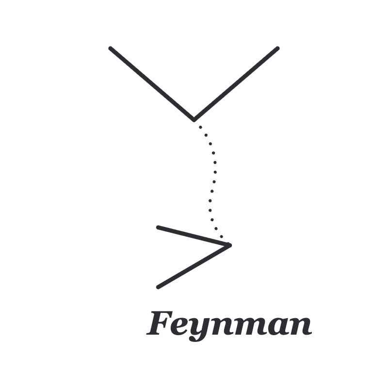
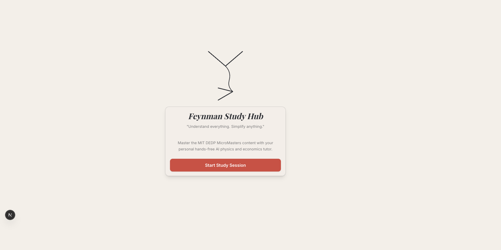
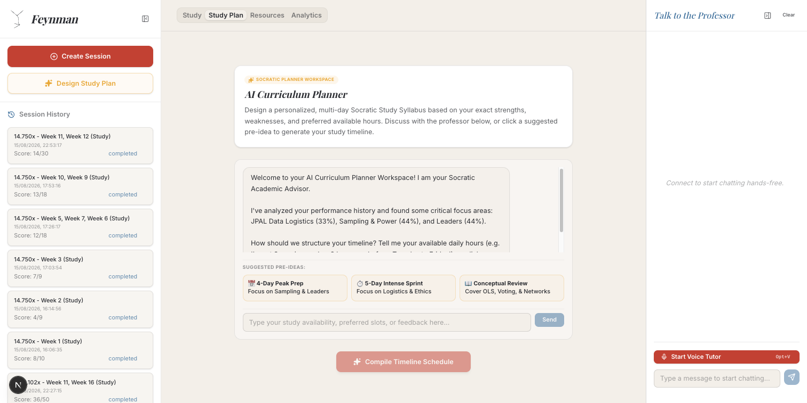
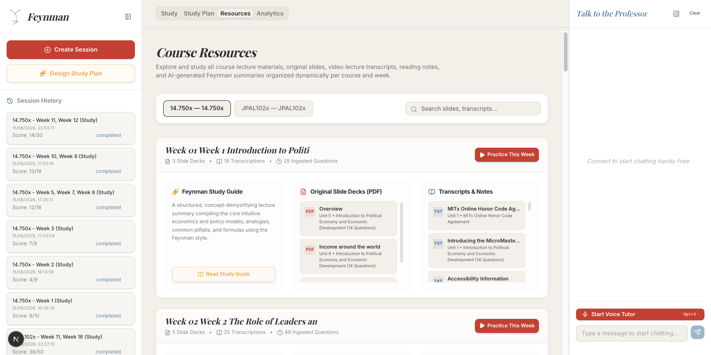

# 🎓 Feynman Study Platform
### *Personal Socratic AI Tutor & Adaptive Study Workspace for Your Own Course Material*

<p align="center">
  
</p>

The **Feynman Study Platform** turns the course files you already have (lecture notes, slides, transcripts, problem sets) into a private study workspace: it organizes them into modules, imports the questions they contain, writes more practice questions, and tutors you in chat or by voice. Everything runs on your own machine, with your own Gemini API key.

**Course material and attribution**: the author's own studyspaces use material from MITx courses (14.740x, 14.750x, JPAL102x). That material is **not** part of this repository and stays on the author's machine. See [ATTRIBUTION.md](ATTRIBUTION.md) for the courses, how they are referenced in the app, and the terms.

### 🌟 Origins of the Platform
The platform came out of my own studies for **MIT's Data, Economics, and Development Policy (DEDP) MicroMasters**. Faced with mathematically rigorous econometric papers, regression tables and lecture slides, I looked for an active-learning assistant that handled typeset formulas, diagnosed conceptual gaps and could tutor hands-free by voice, and found none. So I built one. It started pre-seeded for two courses and is now a general tool: you create a *studyspace* for any subject and upload your own files.

---

## 🚀 What It Does

### Studyspaces: one workspace per course
* **New studyspace wizard**: name it, upload `.txt`, `.md` or `.pdf` files (scanned PDFs are read with a Gemini OCR fallback), watch the processing, review the outline, accept the tutor profile. Add more files later from the Resources tab.
* **Automatic organization**: each file is split into modules and topics with summaries and key terms; you can rename, move and merge them in the outline editor. A topic that is course logistics rather than study material is recognized and skipped.
* **Questions already in your files are imported, never invented**: multiple choice, numeric, fill-in-the-blank and written-answer questions are imported only when the file states the answer (an answer key, a marked option, a written model answer), and every imported question must grade as correct against its own key.
* **A tutor profile per studyspace**: the AI proposes the subject, level, tone, analogy domains and the mix of question types from your files; you edit and accept it.

### Practice questions you can trust
* **Five question types**: single choice, multiple choice (with *one-wrong-cancels-one-right* partial credit), numeric, dropdown, and **written answers** graded against key points by the model.
* **AI-written questions with a quality gate**: every generated question passes structure checks and an **independent blind solve** (a second model call that sees only what you see) before it is ever shown. Rejected ones are stored for audit and never selected.
* **Multi-part problems**: a shared setup (model, scenario, figure) with 3 to 5 chained parts, shown with the setup pinned above each part and a strip of numbered parts with their state. They can be imported from your files or written by the AI, with real problems from your course as style examples.
* **Typeset mathematics** (KaTeX) everywhere, including money amounts that are not math.

### Studying
* **Course weeks as modules** and **homework vs. short in-lecture exercises** as separate classes, so progress and results are tracked per week and per kind.
* **Session configuration**: a weeks picker with questions, progress and accuracy per week; goal presets (*Quick 10*, *Weak spots*, *New material*, *Problems*, *Exam simulation*); a **Kind** filter; a live summary of what the session will draw and how many questions the AI would write; your last settings are remembered.
* **Practice or timed exam**: exams have a server-side deadline, draft answers that survive a reload, flagging, and hidden answers until you submit. Sessions are resumable.
* **Adaptive mix**: weak topics first, unseen material, and spaced review of what you know; mix stored questions with fresh AI ones, or use course questions only (no AI cost).
* **Socratic tutor** in chat or by voice (Gemini Live), in three modes (*probe*, *guide*, *explain*), with the current question as context. On a phone the tutor is a bottom sheet.
* **Analytics and diagnosis**: accuracy by week and topic, an AI diagnosis of your conceptual gaps after exams, a Socratic planner that builds a multi-day schedule, and *Feynman study guides* for each module.
* **On your phone**: installable as a home-screen app, and reachable on your private Tailscale network with one switch (never on the public internet).

### Screenshots
*Screenshots are from an earlier version of the interface.*

<p align="center">
  
  
</p>
<p align="center">
  
  
</p>
<p align="center">
  
  
</p>

---

## 📋 Requirements

* **Node.js 22.12 or newer** (the SQLite driver needs Node 22+, Prisma 22.12+; developed on 22.14) and npm
* A **Gemini API key** from Google AI Studio (next section)
* Optional: **Tailscale** to open the app on your phone, and macOS for the `launchd` background service and `scripts/run.sh` phone helpers

---

## 🔑 Get a Gemini API key (Google AI Studio)

1. Open **https://aistudio.google.com/apikey** and sign in with a Google account.
2. A new user accepts the Terms of Service and gets a default project and key. If you already use a Google Cloud project, import it first (*Dashboard → Projects → Import projects*), then create the key in that project on the **API keys** page.
3. Copy the key. In the key's settings choose **Add restrictions → Restrict to Gemini API only**.
4. Put the key in `web/.env` (see Quick start). The app reads **two** variables, so use the same key in both:
   * `GOOGLE_GENERATIVE_AI_API_KEY`: text generation, question import and the tutor chat
   * `GOOGLE_API_KEY`: the voice tutor (the app also accepts `GEMINI_API_KEY` for this one)
5. Never commit the key. `web/.env` is git-ignored.
6. To go beyond the free tier, link a billing account to the key's project and set a **budget alert** in the Google Cloud console.

If the *Create API key* button is disabled, your Google account lacks permission on that project; use a personal project instead.

---

## 💰 Estimated Cost

The platform has no hosting cost: the database is a local SQLite file. The only cost is the Gemini API. The app uses **`gemini-3.6-flash`** for text and `gemini-3.1-flash-live-preview` for the voice tutor.

**Prices** (from Google's [pricing page](https://aistudio.google.com/docs/pricing), checked November 2026, per million tokens):

| | Free tier | Paid, until 31 Dec 2026 | Paid, from 1 Jan 2027 |
|---|---|---|---|
| Text input | free | $0.75 | $1.50 |
| Text output (including thinking) | free | $3.75 | $7.50 |
| Voice tutor, audio in / out | free | about $0.005 / $0.018 per minute | check the page |

The **free tier** costs nothing but is rate-limited, and Google's free tier has its own data-use terms: read them on the pricing page before uploading private material. Prices change, so confirm them before relying on these figures.

**Rough estimates** at today's paid prices (my estimates from the app's prompt sizes, not measured bills: expect them to be off by up to 2x either way, and double them after 1 Jan 2027):

| What | Roughly | Notes |
|---|---|---|
| Reading a whole course into a studyspace | $1 to $4 | one-off; a course of about 1.2 million tokens of text (lectures, exercises and 50 PDFs) is at the high end |
| Starter questions after you accept the tutor profile | $2 to $4 | one-off batch of 100 to 200 AI-written questions for a large studyspace |
| One AI-written question | about $0.02 | a generation call plus the blind-solve check, with the occasional retry |
| One AI-written multi-part problem | about $0.04 | one generation call plus a check per part |
| A 20-question session, **course questions only** | $0 | the presets use course questions only |
| A 20-question session at the default 50% AI mix | about $0.20 | 10 AI-written questions |
| 30 tutor chat messages | about $0.30 | each message carries the question and topic as context |
| Voice tutor | up to about $0.02 per minute | an upper bound: audio out is only billed while the tutor speaks |
| A Feynman study guide or an AI diagnosis | $0.02 to $0.06 | one call over a module's text |

**In practice**: studying from imported questions with some chat is a few dollars a month at most; heavy use with many AI-written questions and the voice tutor can reach tens of dollars. To keep it low: use the presets or set the sourcing mix to *100% ingested*, accept the tutor profile only when you want the starter batch, use text chat instead of voice, and set a budget alert.

---

## ⚡ Quick Start

```bash
git clone https://github.com/jpmcarrilho/feynman.git
cd feynman/web
npm install
cp .env.example .env
```

Edit `web/.env`:

```bash
GOOGLE_GENERATIVE_AI_API_KEY=your_gemini_api_key_here
GOOGLE_API_KEY=your_gemini_api_key_here     # the same key, used by the voice tutor
APP_PASSCODE=choose-a-passcode              # the passcode you type to enter the app
DATABASE_URL=file:./dev.db
```

Create the database and start the app:

```bash
npx prisma generate        # builds the database client
npx prisma migrate deploy  # creates web/dev.db with all tables
npm run dev
```

Open **http://localhost:3000**, enter your passcode, choose **New studyspace**, give it a name and upload some `.txt`, `.md` or `.pdf` files. When processing finishes, review the outline, accept the tutor profile and start a session.

Or let a script pick a free port and set up the phone address: `scripts/run.sh` (development), `scripts/run.sh --prod` (production build, quieter), `scripts/run.sh --dry-run` (shows what it would do). See [web/README.md](web/README.md) for the phone and background-service details.

**Where your data lives** (all git-ignored; back up `web/dev.db` before big changes):
* `web/dev.db`: the database (studyspaces, topics, questions, your sessions and answers)
* `web/storage/`: the files you uploaded and their extracted text
* `web/summaries/`: generated study guides and session indexes

### Question files the importer understands
A Markdown file with edX-style blocks is imported without a model call:

```markdown
# Question
Which of these is true?

## Choices
- [ ] A wrong option
- [x] The right option

## Explanation/Solution
Explanation

Why it is right.
```

* A numeric answer box is written as `- [x] 25.61` (several boxes: `- [x] Mean: 4.19`).
* A **multi-part problem** wraps its questions in a `# Problem set: <title>` section that starts with `## Shared context` (the setup) and ends with `# End of problem set`.
* Any other file is read by the model, and a question is imported only if the file states its answer.

### Working with course folders you saved yourself
`web/src/scripts/build-edx-exercises.ts` turns a folder of exercises into upload files (it finds the multi-part problems and keeps homework and finger exercises apart), and `web/src/scripts/relabel-weeks.ts` labels a studyspace's topics with the course weeks. Both are described in their headers. Course files stay in the git-ignored `MIT_Learn_Courses/` folder on your machine.

---

## 🛠️ Tech Stack

* **Frontend**: React 19, [Next.js 16](https://nextjs.org/) (App Router, Server Actions), Tailwind CSS 4, [shadcn/ui](https://ui.shadcn.com/)
* **Database**: SQLite through [Prisma 7](https://www.prisma.io/) with the `better-sqlite3` adapter
* **AI**: Vercel AI SDK with Google Gemini (`gemini-3.6-flash` for text, Gemini Live for voice), structured outputs with Zod
* **Math and charts**: [KaTeX](https://katex.org/), [Recharts](https://recharts.org/)
* **Files**: `pdf-parse` for PDFs, Gemini OCR for scans
* **Tests**: Vitest (unit, component and database tests) and Playwright (end to end)

## 📂 Project Structure

```
feynman/
├── ATTRIBUTION.md             # Where the course material comes from, and the terms
├── LICENSE                    # Software license and content notice
├── scripts/
│   ├── run.sh                 # Start the app (free port, phone address)
│   └── launchd/               # Install/uninstall the macOS background service
└── web/                       # The Next.js application
    ├── prisma/                # schema.prisma and the migrations
    ├── public/                # Icons, manifest assets, screenshots
    └── src/
        ├── app/               # Routes and Server Actions
        ├── components/        # Study interface, session configuration, analytics
        ├── lib/               # Pure logic: grading, validation, prompts, session config
        ├── server/ingest/     # Upload pipeline: extract, segment, import questions
        ├── services/          # Sessions, generation, enrichment, studyspaces
        └── scripts/           # Course-folder tools (see above)
```

## 🧪 Tests

```bash
cd web
npm run test        # Vitest: about 1,800 tests
npm run typecheck   # TypeScript
npm run test:e2e    # Playwright
```

## 📖 More Documentation

* **[ATTRIBUTION.md](ATTRIBUTION.md)**: the course material, how it is referenced, and the terms
* **[web/README.md](web/README.md)**: phone access, the background service, Cloud Run deployment
* **[web/STUDYSPACES_PLAN.md](web/STUDYSPACES_PLAN.md)**: the design and the measurements behind the studyspace pipeline
* **[web/QUESTION_GENERATION.md](web/QUESTION_GENERATION.md)**: question sourcing, generation, exams and scoring
* **[web/IDEAS_GRAPH_RAG.md](web/IDEAS_GRAPH_RAG.md)**: ideas for a knowledge-graph pipeline

## 🔮 Roadmap

**Done**: upload your own files, automatic modules and topics, question import from files, five question types including graded written answers, multi-part problems, week and kind organization, session configuration, phone access, the voice tutor.

**Next**
* Make the multi-part problem view a single scrolling page of all parts.
* Code-verified numeric answers for AI-written problems (the model also writes a small program that computes each answer, and parts that disagree are rejected).
* Make data-dependent exercises answerable by putting the needed statistics in the question.
* Accuracy by kind (homework vs. finger exercises) in Analytics.
* Longer term: a knowledge graph of prerequisite concepts for targeted remedial lessons, a shared chalkboard with the live tutor, answer-latency based spaced repetition, and AI peer debate seminars.

**Contributions are welcome**: open an issue or a pull request.

---

## 🛡️ Legals, Copyright & Compliance Safety-Net

This repository has been structured with extreme legal rigor to protect both developers and contributors. By enforcing the boundaries below, this project establishes a bulletproof copyright and safety-net defense:

### 1. Zero Copyrighted Materials Distributed
* **No Content Hosting**: **This repository contains exactly 0% copyrighted lecture slide PDFs, protected university transcripts, protected test questions, or proprietary textbooks.** 
* **Local-Only Execution**: The codebase is a set of open-source algorithmic instructions. All data ingestion or seeding (`seed.ts`) occurs **entirely locally on the student's personal machine**.
* **Personal Authorization**: The platform only processes files that the student already has legitimate, authorized personal access to (such as files downloaded under their own credentials on university edX/MITx portals or course directories).

### 2. Creative Commons (CC BY-NC-SA 4.0) Compliance
Any study materials from MIT OpenCourseWare (OCW) or public MITx courses are protected under Creative Commons BY-NC-SA 4.0. This repository fully complies with and enforces this license:
* **Attribution (BY)**: Appropriate credit is programmatically and visually given to MIT OpenCourseWare and original faculty authors (*Benjamin Olken*, *Abhijit Banerjee*, *Esther Duflo*, *Daron Acemoglu*, etc.) in all dashboards.
* **Strict Non-Commercial Use (NC)**: This project contains **zero** commercial intent, advertising, paywalls, premium tiers, or SaaS monetization. It is shared for free as an open-source educational utility under the MIT software license. It is strictly for personal, non-commercial self-study.
* **ShareAlike (SA)**: Any adapted, modified, or fork version of this codebase that integrates original or derivative CC-licensed educational files must be shared under the exact same **CC BY-NC-SA 4.0** license terms.

### 3. Legal Safe Harbor & Disclaimers
* **Unofficial Educational Tool**: This is an independent, unofficial study platform developed by students, for students. It has **no** endorsement, affiliation, sponsorship, joint venture, or authorization from the Massachusetts Institute of Technology (MIT), edX, MITx, or the JPAL program.
* **Trademark Use**: The terms "MIT", "MITx Online", "MIT OpenCourseWare", and all related logos are trademarks of their respective owners. They are used here purely for nominative, descriptive, and non-commercial educational purposes, which qualifies as Fair Use under trademark law.
* **Takedown & Good Faith Compliance**: In the event that any institution, copyright holder, or faculty member objects to any code reference or default indexing pattern, we commit to immediate good-faith cooperation. Please file an issue on this repository, and any references will be removed or altered within 24 hours.

### 4. Software License
The software's structural source code, database structures, and Next.js interfaces are released under the open-source **MIT License**. Any local, user-supplied course assets or processed metadata remain under the respective intellectual property licenses of their original authors or the **CC BY-NC-SA 4.0** license.

---

### *“Understand everything. Simplify anything.”* — Richard Feynman

